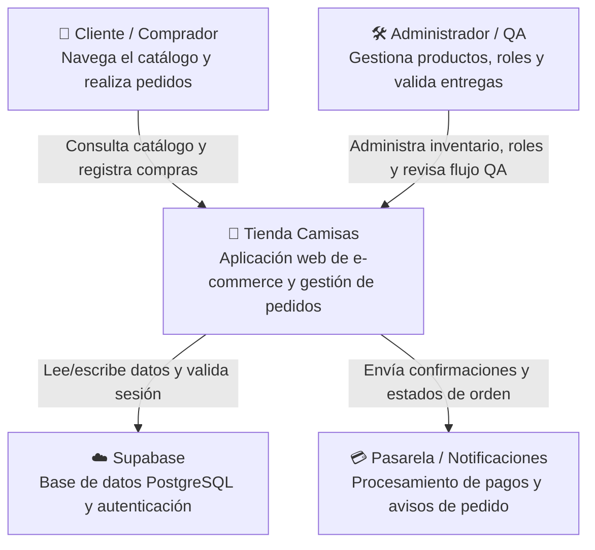
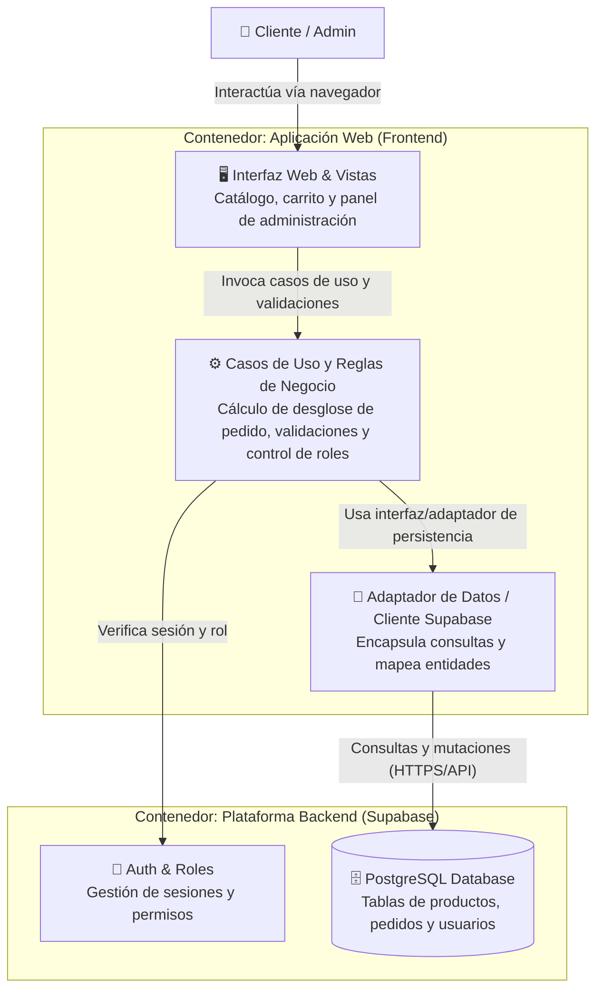

# Arquitectura del Sistema (Modelo C4)

## Nivel 1 · Diagrama de Contexto del Sistema

Muestra el sistema de ventas de camisas (*Tienda Camisas*) en su entorno, los actores que interactúan con él y los sistemas externos de los que depende.

### Justificación · Nivel 1 (Contexto)
* **Delimitación clara del alcance:** Separa el sistema central de e-commerce de los actores externos (`Cliente`, `Administrador / QA`) y de las dependencias externas (`Supabase` y servicios de pago/notificación).
* **Trazabilidad de reglas de negocio:** Permite ubicar dónde residen las validaciones de pedidos, cálculos de totales y permisos por rol antes de bajar a detalles técnicos de implementación.

---

## Nivel 2 · Diagrama de Contenedores

Detalla las piezas ejecutables/almacenamiento principales dentro del sistema y cómo se comunican entre sí.

### Justificación · Nivel 2 (Contenedores)
* **Separación de responsabilidades y regla de dependencia:** La capa de interfaz (`Interfaz Web & Vistas`) y las reglas/casos de uso (`Cálculo de desglose de pedido`, validaciones y control de roles) se mantienen desacopladas de los detalles de infraestructura (`Supabase` / `PostgreSQL`).
* **Facilidad de pruebas y evolución:** Aislar el acceso a datos detrás de un adaptador permite probar la lógica de negocio sin depender directamente de la base de datos remota y facilita cambiar o extender integraciones en el futuro.